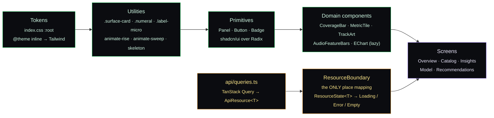

<h1 align="center">Engineering deep dive</h1>

<p align="center">
  <i>The long version of the <a href="README.md">README</a>: every measurement with the configuration that<br/>
  produced it, both quality gates, the decisions and their rationale, the API contract and the design system.</i>
</p>

<p align="center">
  <a href="README.md">README</a> &nbsp;·&nbsp;
  <a href="GETTING_STARTED.md">Getting started</a> &nbsp;·&nbsp;
  <a href="ARQUITETURA.md">Code walkthrough (PT-BR)</a> &nbsp;·&nbsp;
  <a href="deploy/DEPLOY.md">Deploy runbook (PT-BR)</a>
</p>

---

## Contents

- [The data pipeline](#the-data-pipeline)
- [Measured, not claimed](#measured-not-claimed)
  - [Popularity model: champion election](#popularity-model-champion-election)
  - [Recommender: three verifiable proxies](#recommender-three-verifiable-proxies)
  - [Free-tier footprint](#free-tier-footprint)
- [Quality gates](#quality-gates)
- [Data provenance](#data-provenance)
- [Engineering decisions](#engineering-decisions)
- [API surface](#api-surface)
- [Design system](#design-system)
- [Known limitations](#known-limitations)
- [Reproducing the README insights](#reproducing-the-readme-insights)

---

## The data pipeline

The Spotify Web API **removed the audio-features endpoint in November 2024**, and that single
constraint shaped the whole project. Audio features come from a public Kaggle dataset instead, and the
playlist co-occurrence signal from a second one. Neither CSV is versioned here.

```mermaid
flowchart LR
    subgraph SRC["Sources"]
        KG[/"Kaggle · Spotify Tracks<br/><sub>maharshipandya · ~114k rows<br/>audio features + genre</sub>"/]
        PI[/"Kaggle · Spotify Playlists<br/><sub>Pichl et al. · ~1.18 GB<br/>user_id · playlist · artist · track</sub>"/]
        API[/"Spotify Web API<br/><sub>Client Credentials · retry/backoff<br/>429 + Retry-After · pagination</sub>"/]
    end

    subgraph ING["Ingestion · Catalog"]
        SC["seed-catalog<br/><sub>tracks + measured features</sub>"]
        SR["seed-references<br/><sub>artists + albums, linked</sub>"]
        SP["seed-playlists<br/><sub>streamed, grouped, matched<br/>by normalised TrackMatchKey</sub>"]
        IN["IngestPlaylistCommand<br/><sub>idempotent · Outbox</sub>"]
        MT["TrackMatcher<br/><sub>track_id → artist+title → +duration</sub>"]
        IM["MedianAudioFeatureImputer<br/><sub>genre median → global median<br/>marks IsImputed</sub>"]
    end

    CATDB[("catalog.*<br/><sub>89,740 tracks · 29,811 artists<br/>57,637 albums · 37,121 playlists · 113 genres</sub>")]

    subgraph ML["Prediction"]
        DS["TrainingDatasetAssembler<br/><sub>deterministic hash split, seed 20260730<br/>71,762 train / 17,978 test</sub>"]
        TR["FastTree regression<br/><sub>plus mean and linear baselines</sub>"]
        EL["FeatureSetChampionElection<br/><sub>a block survives only if it wins<br/>at least 2% MAE on its own</sub>"]
        MV[("prediction.model_versions<br/><sub>bytea + metrics + feature importance</sub>")]
        SI["SimilarityIndex<br/><sub>z-score → cosine → kNN top-N<br/>built in memory, in the background at startup</sub>"]
    end

    CO["build-cooccurrence<br/><sub>pairs in 2+ playlists → Jaccard</sub>"]
    CODB[("prediction.track_cooccurrence<br/><sub>1,481,511 pairs · 254 MB</sub>")]

    subgraph OUT["Served"]
        EDA["/api/insights/*<br/><sub>Dapper · ROW_NUMBER() + COUNT(*) OVER()</sub>"]
        PRED["/api/predictions/popularity"]
        REC["/api/recommendations/track/:id<br/><sub>strategy=content or blend</sub>"]
    end

    KG --> SC --> CATDB
    KG --> SR --> CATDB
    PI --> SP --> CATDB
    API --> IN --> CATDB
    SC -.-> MT
    SP -.-> MT
    MT -.-> IM -.-> CATDB

    CATDB --> DS --> TR --> EL --> MV --> PRED
    CATDB --> SI --> REC
    CATDB --> CO --> CODB --> REC
    CATDB --> EDA

    classDef src   fill:#06070a,stroke:#f0a742,color:#fde68a
    classDef step  fill:#0b0c10,stroke:#1DB954,color:#d1fae5
    classDef ml    fill:#0b0c10,stroke:#a78bfa,color:#ede9fe
    classDef out   fill:#0b0c10,stroke:#3b82f6,color:#dbeafe
    classDef db    fill:#4169E1,stroke:#93c5fd,color:#ffffff,stroke-width:3px

    class KG,PI,API src
    class SC,SR,SP,IN,MT,IM,CO step
    class DS,TR,EL,SI ml
    class EDA,PRED,REC out
    class CATDB,MV,CODB db
```



**Track matching** is a chain of strategies, not a single join: exact `track_id` first, then
normalised `artist + title`, then `title + duration` to break homonyms. Every run reports its **match
rate**, fallback share, duplicates and imputation rate, because a load that silently half-worked is a
load that failed.

---

## Measured, not claimed

Everything below is reproduced by `dotnet test` (deterministic fixtures) or by re-running the training
endpoint against the seeded catalogue with the recorded seed.

### Popularity model: champion election

Same split, same seed (`20260730`), same trainer (FastTree). Four feature sets measured, one elected.

| Feature set | R² | MAE | RMSE | MAE gain | Verdict |
|---|---:|---:|---:|---:|---|
| Baseline, always predict the mean | -0.0001 | 17.2555 | 20.5634 | n/a | reference |
| Baseline, linear (SDCA) | 0.0358 | 16.6640 | 20.1900 | n/a | reference |
| Base: 9 audio features + duration + explicit | 0.1519 | 15.1680 | 18.9356 | n/a | starting point |
| **+ A**: key / time-signature one-hot, mode boolean | 0.1524 | 15.1862 | 18.9303 | **-0.12%** | ❌ does not pay, **removed** |
| **+ B**: genre one-hot (113 plus an `<unknown>` bucket) | **0.3927** | **11.5396** | **16.0240** | **+23.92%** | ✅ **champion** |
| A + B | 0.3949 | 11.5076 | 15.9945 | n/a | carries a rejected block |

**Champion: base plus genre.** Against the mean baseline that is **MAE 33.1% lower**. 5-fold
cross-validation puts R² dispersion at **0.0046**, which is what licenses reading the
feature-importance ranking as a learned mechanism rather than a ranking of noise.

The result contradicted the project's own prior. At the EDA stage the strongest Pearson correlation
against popularity was **0.127**, and the prediction on record was that the gate would fail. Weak
*linear* correlation is not absence of signal: FastTree picks up non-linearity and feature interaction
that Pearson cannot see, and `duration_ms` / `explicit` were not even in the correlation run.

**Feature importance** is measured once at training time by permutation over the test set (5
permutations per slot), stored as jsonb alongside the version and served by `GET /api/model/current`.
The 113 genre columns are aggregated into a single `Genre` row, where means add and dispersions add in
quadrature, because each permutation is an independent draw. The endpoint's own documentation states
the caveat: with correlated features (Energy against Loudness, measured at EDA time), low importance
means *"the model did not need this column given the rest of the vector"*, never *"this quantity is
unrelated to popularity"*.

### Recommender: three verifiable proxies

There is no user ground truth, so quality is measured by proxies over the real catalogue. Fixed,
seeded sample (`e4.4-proxies-v1`): **300 seeds, top-10**.

**Every number below carries the configuration that produced it.** The first measurement, taken
2026-08-13, predated two things that are now on by default: the near-duplicate collapse (`dedupe=true`)
and the collaborative blend. Numbers without their configuration described, for two epics, a system the
endpoint no longer served. The re-measurement below was taken 2026-09-12 on the same seeded sample.

| Proxy | Config | 2026-08-13 | 2026-09-12 | Reads as |
|---|---|---:|---:|---|
| Genre coherence | `off \| dedupe=on \| content` | 0.1347 *(dedupe=off)* | **0.1140 ± 0.1734** | the floor the boost is measured against |
| Genre coherence | `boost 0.050 \| dedupe=on \| content` | 0.5833 *(dedupe=off)* | **0.5563 ± 0.3608** | 4.88x lift, the boost is actually breaking ties |
| Genre saturation | `boost 0.050 \| dedupe=on \| content` | 0.3100 | **0.2800** | minority, so still a boost and not a filter |
| Self-exclusion violations | both of the above | 0 / 300 | **0 / 300** | the seed never recommends itself |
| Duplicate recall | `off \| dedupe=off \| content` | 0.6108 *(8-member cap)* | **0.6464** *(no cap)* | near-duplicates land in the top-K |
| Duplicate hit rate | `off \| dedupe=off \| content` | 0.6745 *(8-member cap)* | **0.7037** *(no cap)* | share of seeds with at least one sibling found |
| Mean sibling cosine | `off \| dedupe=off \| content` | 0.998244 | **0.999028** | the most sensitive break detector in the suite |
| Same work twice in one top-N | `off \| dedupe=off \| content` | not measured | **1,768 / 1,895** | the pain the collapse exists to remove |
| Same work twice in one top-N | `off \| dedupe=on \| content` | not measured | **0 / 1,895** | the collapse's proof of value, finally a number |
| Top-10 entirely duplicates | `off \| dedupe=off \| content` | 0 *(8-member cap, a structural zero)* | **1,473 / 1,895** *(measured 2026-10-10)* | for most seeds in large groups the whole list was the seed's own work |
| Top-10 entirely duplicates | `off \| dedupe=on \| content` | not measured | **0 / 1,895** *(measured 2026-10-10)* | the collapse removes the worst case completely |

Coherence carries its **standard deviation** because comparing two configurations by bare means cannot
tell an effect from a draw of the sample. With σ and n, the reader computes the standard error and
decides whether a delta is signal.

Proxy 3 (duplicate proximity) is **always measured with genre switched off**, because it is the only
non-circular guard. Genre coherence measured over a genre-boosted ranking partly measures the boost
itself; duplicate proximity does not use genre at all, so if normalisation or the cosine break, it is
the first to fall. It is anchored on `catalog.tracks.match_key`, verified by SQL before use: **7,015
groups, 19,388 tracks, 36,940 pairs, largest group 54**, the same number that sized the dedup work.

The 2026-08-13 run capped groups at **8 members**, which made "top-10 entirely duplicates" *arithmetically*
impossible: with top-10, a seed needs 10 siblings to saturate its own list. Removing the cap and measuring
the **111 groups of 11+ tracks** (1,895 seeds, 18,892 of the 36,940 pairs) is what turned that indicator
from a structural zero into a real reading: with the collapse off, 1,473 of those 1,895 seeds get a top-10
made of nothing but other versions of the seed itself, and with it on, none do.

#### Two findings from the re-measurement, both closed

**The blend was dropping the genre boost from the final ordering, and the instrument that measured it
was doing the same thing.** The blender re-ranked by min-max rescaled *cosine*, not by the hybrid score,
so `genreMode=boost` shaped which candidates were fetched but no longer ordered them. On the 37 of 300
seeds that actually have co-occurrence, coherence fell from **0.5324 ± 0.3480** (content) to
**0.1676 ± 0.2537** at `blendWeight=0.35`. What made the finding harder to spot: the
`RecommenderQualityEvaluator` contained the same bug in two places (`neighbor.CosineSimilarity` where
the contract required `neighbor.Similarity`, the hybrid score), so the evaluation harness itself was
measuring the blend with naked cosine. The numbers were describing a system that was not what was
running. After the fix (commit `be1d6c0`, card E4.10), on those same 37 seeds, the effect goes from
**-5.15σ to +0.30σ** at `blendWeight=0.35` and from -3.96σ to +0.80σ at `blendWeight=0.60`. The -5.15σ
reproduces the original signal, which validates the measurement method. Product decision: the boost
enters the sort key, and the score exposed to the caller is exactly the value that ordered the list.

**Near-duplicate collapse was returning fewer results than requested, now fixed by adaptive over-fetch.**
A seed inside a large duplicate group had a 3x over-fetch made almost entirely of its own siblings,
which collapsed into a single entry. Measured on the live endpoint at
`genreMode=boost&dedupe=true&limit=10`: **679 of the 1,895 seeds in 11+ groups got fewer than 10
recommendations and 227 got exactly one**. The fix (commit `e5ab833`, card E4.9) over-fetches once in
the maximum window and post-processes a prefix per round, which is exact rather than approximate because
the heap breaks all ties by `trackId`. Cap of 3 rounds; across 1,895 seeds: 64.2% resolved in round 1,
29.7% in round 2, 6.2% in round 3, zero seeds hit the cap without resolving. Outcome: **below 10
recommendations 679 to 0; exactly 1 recommendation 227 to 0; average list size 7.87 to 10.00**. The
gate grew from 7 to 9 thresholds (the two new ones being `MaximumShortResultRate = 0.05` and
`MaximumSeedsWithSingleResult = 0`); none of the previous seven thresholds regressed or had their
target moved.

### Free-tier footprint

Container `spotifydataanalysis-api` against Postgres with the full dataset. Full runbook and methodology
in [`deploy/DEPLOY.md`](deploy/DEPLOY.md), including known limitations of the current measurement.

The RAM table below was measured against commit `e5ab833` (adaptive over-fetch, E4.9) with the version
of `deploy/measure-latency.ps1` from commit `53d78e4` (2026-09-13): 300 deterministic seeds, 3 rounds,
1,800 sequential requests per tier. The current script no longer reproduces that table: it measures
latency and cold start (second table below), not RAM, and it does not run the `blend` strategy. RAM was
read from `docker stats` after the full run (current usage at that moment, not historical peak). No
CPU throttle was applied, and the Docker VM had 20 CPUs, so these RAM numbers do not represent the real
free-tier constraint, where CPU is the bottleneck.

| Scenario | RAM after run | OOM |
|---|---:|:--:|
| 512 MB, no CPU limit | 310.9 MiB | no |
| 256 MB, no CPU limit | 148.3 MiB | no |

Latency and cold start of `GET /api/recommendations/track/{id}?limit=10&strategy=content`, measured
2026-10-10 against application commit `d7bc20a` (89,740 tracks in the database), with
`deploy/measure-latency.ps1` as of commit `a38e8c6`. Docker Desktop on WSL2, VM with 20 CPUs and 16 GB.
Load generator: k6 v2.3.0 (`grafana/k6` container, pinned by digest) on the same Docker network as the
API, one virtual user, sequential requests. Each round is one pass over the 300 deterministic seeds
(`e4.4-proxies-v1`, same order every time), 5 rounds per scenario. Before the first scenario, a pre-flight
container requested all 300 seeds, so every measurement, cold starts included, ran with the Postgres and OS
caches already warm for those seeds. Each scenario then starts the container 3 times (cold start, timed
from the `docker run` call) and the load runs on the third start. Before the rounds, requests are
discarded as warm-up in windows of 20 (the same 20 seeds each time) until the mean of two consecutive
windows differs by less than 10%, with a floor of 50 and a cap of 200; 80 to 100 were discarded, and the
cap was never reached. Scenarios always run in the same order (0.1 CPU before no limit, 512 MB before
256 MB). The `blend` strategy is not measured.

Latency columns: median across the 5 rounds, with the range across rounds (max minus min) in parentheses.
Cold start columns: median of the 3 starts, with the range (min to max) in parentheses.

| Scenario | Mean (ms) | p50 (ms) | p95 (ms) | p99 (ms) | Cold start to `/health` (s) | Cold start to first recommendation (s) |
|---|---:|---:|---:|---:|---:|---:|
| 512 MB, 0.1 CPU | 118.5 (48.8) | 101.2 (5.0) | 192.6 (113.2) | 201.0 (304.4) | 18.5 (18.5 to 19.4) | 20.8 (20.7 to 21.8) |
| 256 MB, 0.1 CPU | 116.1 (45.9) | 101.2 (6.1) | 192.3 (111.3) | 292.4 (299.4) | 19.3 (18.7 to 19.6) | 21.5 (20.9 to 21.9) |
| 512 MB, no CPU limit | 14.2 (0.8) | 14.1 (0.7) | 15.8 (1.7) | 17.9 (2.9) | 1.57 (1.50 to 1.75) | 2.10 (2.08 to 2.16) |
| 256 MB, no CPU limit | 13.7 (0.5) | 13.6 (0.3) | 15.5 (1.9) | 18.2 (1.2) | 1.61 (1.52 to 1.65) | 2.13 (2.06 to 2.26) |

Mean latency per round at 0.1 CPU (ms), rounds 1 to 5:

| Scenario | R1 | R2 | R3 | R4 | R5 |
|---|---:|---:|---:|---:|---:|
| 512 MB, 0.1 CPU | 156.6 | 125.6 | 118.5 | 108.6 | 107.8 |
| 256 MB, 0.1 CPU | 149.3 | 153.2 | 109.4 | 116.1 | 107.3 |

What this says: CPU is what moves latency. The mean at 0.1 CPU was still falling when the measurement
ended, so the median of the 5 rounds is an upper bound on the regime, not the regime itself, and the
ratio to the unthrottled mean depends on the round: from about 7.6 times (round 5) to about 10.4 times
(round 1) at 512 MB, and from 7.7 to 10.7 times at 256 MB. The first recommendation takes about 21 s at
0.1 CPU against about 2 s without a limit.

RAM tier: the 256 MB versus 512 MB difference in the mean (256 MB slightly faster in both CPU settings:
-2.4 ms at 0.1 CPU, -0.5 ms without a limit) is inside the range across rounds (about 45 ms at 0.1 CPU,
about 1 ms without a limit). Only an effect larger than that range could have been detected, and because
256 MB always ran after 512 MB, a small effect of the RAM tier cannot be separated from an order effect.
The application used about 150 to 170 MiB at the 256 MB tier, so no large effect was expected.

Under 0.1 CPU (a CFS quota, throttled in 100 ms slices) the latency looks bimodal, near 100 ms and near
190 ms. That is inferred from p50 and p95; the script keeps no histogram. The p99 reaches 292 ms (median)
at 256 MB and about 490 ms in round 1 of both tiers, which suggests a tail beyond the second mode. The
percentiles swing a lot between rounds; read them with the range next to them. With the limit set,
`cpu.stat` of the container's cgroup confirmed the throttle (1,859 of 1,873 periods throttled at 512 MB,
1,917 of 1,936 at 256 MB). Without the limit, the script only checks that the container was started with
no CPU limit (`NanoCpus` equal to 0). Docker Desktop on WSL2 gives a same-machine comparison between
scenarios, not a production promise: client, API and Postgres share the host, and a managed free-tier
provider will differ.

Database on disk, re-measured 2026-09-12 with `pg_total_relation_size`:

| Relation | Rows | On disk |
|---|---:|---:|
| `prediction.track_cooccurrence` | 1,481,511 | **254 MB** |
| `catalog.tracks` | 89,740 | 95 MB |
| `catalog.playlists` | 37,121 | 15 MB |
| **database total** | | **388 MB** |

**Verdict on the ~0.5 GB free-tier budget: it fits, with 124 MB of headroom (76% used).** The blend is
what consumes it: the co-occurrence matrix alone is 65% of the database and half the budget, to serve
a signal that covers **9,664 of 89,740 tracks (10.8%)**, and only **37 of the 300 sampled seeds**. That
ratio, not the absolute size, is the argument for pruning the matrix by a minimum `co_playlists` before
the catalogue grows again.

Image: 349 MB. The similarity index fits comfortably in 256 MB with no OOM across 1,800 requests. The
conclusion, *CPU and disk rather than RAM*, is what drove the index to be built in the background at
startup (E6.9), with the endpoint answering 503 until it is ready.

---

## Quality gates

Two gates run inside `dotnet test`. Both are **relative**, and both were calibrated *after* the first
measurement. That is a lesson learned the hard way, when an earlier R²-based gate was written before
measuring and passed by a margin of 0.0019.

### Model gate: `ModelQualityGate`

```
PASS  ⟺  model.MAE ≤ baseline.MAE × (1 - 0.05)
```

Relative to the always-predict-the-mean baseline, **not** an absolute MAE threshold. Only the
comparison answers "did it learn?" without knowing the target's variance in advance, and it stays
valid if the catalogue changes. A rule like `MAE < 12` would be hostage to an invented number.

**R² deliberately does not enter the gate.** With a target this noisy, since popularity is driven by
marketing and editorial playlisting rather than by audio alone, a low R² is the expected result and
not a defect. It is reported as information.

A baseline with zero MAE (constant target) fails every model that is not equally perfect. There is no
percentage to extract from zero, and passing there would mean passing by division by zero.

### Recommender gate: `RecommenderQualityGate`

Nine thresholds, all pinned to measured values, each bound to the configuration that validates it,
with coherence charged from **both sides**:

| Threshold | Value | Validating config | Measured | Why this side exists |
|---|---:|---|---:|---|
| `MinimumGenreCoherence` | 0.40 | `boost 0.050 \| dedupe=on \| content` | 0.5563 | floor, detects the space collapsing, with slack for sample noise |
| `MinimumCoherenceLiftOverCosineOnly` | 2.0x | both sides at the same `dedupe` | 4.88x | the boost must still break ties, so too small a weight fails here |
| `MaximumGenreSaturation` | 0.50 | `boost 0.050 \| dedupe=on \| content` | 0.2800 | **ceiling**: above this the boost decides the list for most seeds and becomes indistinguishable from a hard filter (a weight of 0.08 already fails here) |
| `MinimumDuplicateRecall` | 0.45 | `off \| dedupe=off \| content` | 0.6464 | non-circular guard |
| `MinimumDuplicateHitRate` | 0.50 | `off \| dedupe=off \| content` | 0.7037 | non-circular guard |
| `MinimumSiblingCosine` | 0.98 | `off \| dedupe=off \| content` | 0.999028 | moves only if normalisation or the cosine break |
| `MaximumSeedsWithRedundantSiblings` | 0 | `off \| dedupe=on \| content`, leaders of the 11+ duplicate groups | 0 / 1,895 | the collapse's own promise: the same work never takes two slots |
| `MaximumShortResultRate` | 0.05 | `boost 0.050 \| dedupe=on \| content`, members of the 11+ duplicate groups | 0.0000 (0 / 1,895) | the collapse must not shrink the list: a seed inside a large duplicate group still gets the top-N it asked for |
| `MaximumSeedsWithSingleResult` | 0 | same as above | 0 | a one-item list does not read as a design choice, it reads as a broken recommender, so it is counted apart |

The 2026-09-12 re-measurement **changed no threshold value**. All six original thresholds still hold on
today's default configuration, with room to spare; what changed is that each one now names the config
that validates it, and a seventh was added for the collapse. The eighth and ninth came with the adaptive
over-fetch (E4.9).

The gate **refuses**, with an exception rather than a verdict, to be handed the wrong configuration:
recall and hit-rate measured on an already-deduplicated ranking, a redundancy indicator measured without
the collapse, a lift compared across different `dedupe` settings, or a blended measurement. It also
refuses the wrong **population**. The last three thresholds only mean something on the seeds that
calibrated them: on a sample made of duplicate pairs the redundancy count is zero by arithmetic, with
the collapse on or off, because two versions of the same work in one top-N need a seed and two siblings;
and on randomly drawn seeds the short-list rate is close to zero with or without the adaptive
over-fetch. A measurement that declares another population, or none, is rejected, and so is a redundancy
count taken over zero seeds. A mis-wired gate does not get the number wrong, it gets the *question*
wrong, and would return a confident pass about a different quantity.

> Self-exclusion is not a threshold. Any violation in any run is a failure, because the acceptable
> value is zero.

Failures travel as ready-to-read text carrying the measured value *and* the threshold, because the
consumer is a human reading a red test, and an error code would force them to translate back a number
that had already been measured.

---

## Data provenance

**`measured`, `imputed` and `absent` never share a colour, a label or a code path.** That rule
survives every refactor; breaking it is a defect, not a change of taste.

| Stage | Rule |
|---|---|
| Ingestion | A missing feature is filled with the **genre median** (global median as backstop) and the track is stamped `IsImputed`. Nothing is filled in silence. |
| Training | `ImputedFeaturePolicy.ExcludeImputed` is the default. Median imputation compresses variance and injects a genre-correlated artefact, so the model could learn "this feature equals genre X's median" and use it as a genre proxy, scoring well for the wrong reason. `IncludeImputed` exists only for the robustness read. |
| Recommendation | An imputed seed sets `seedIsImputed` and raises a warning; imputed candidates never receive the genre boost. |
| UI | `--measured`, `--imputed` and `--absent` are distinct tokens, each segment carries its own name in the legend, and **a percentage never appears without its absolute value and base** (`100.0%` next to `89,740 of 89,740 tracks`). |

The same instinct applies to API degradation. `strategy=blend` with an empty co-occurrence matrix
falls back to content-based and says so, in `effectiveStrategy`, `collaborativeSignalUnavailable` and
`warnings`. A seed with no usable genre falls back to pure cosine and sets
`genreFellBackToCosineOnly`. **The consumer is never degraded in silence.**

---

## Engineering decisions

Every decision started as a card on the [Trello board](https://trello.com/b/1nHOJ9P1).

| Decision | Rationale |
|---|---|
| **Kaggle for audio features, not the Spotify API** | Spotify removed the audio-features endpoint in November 2024. The domain models the *source* (`Source`, `IsImputed`) instead of pretending one exists, and the ingestion layer is a multi-source adapter. The constraint is documented, not hidden. |
| **A feature block must earn its place** | `FeatureBlockGainPolicy`: a block stays only if it wins at least 2% MAE on its own, against the same split and seed. Key, mode and time-signature measured 0.12% *worse* and were deleted; genre measured 23.92% better and stayed. The election is a **domain rule** (`FeatureSetChampionElection`), unit-testable without ML.NET. |
| **Gate relative to a baseline, never absolute** | See [Quality gates](#quality-gates). An absolute `MAE < 12` is an invented number that breaks the moment the catalogue changes. |
| **Two-sided gate on the recommender** | A floor-only coherence gate is satisfied by raising the boost weight until it becomes a hard filter, so it would reward the exact failure being diagnosed. Floor plus lift plus saturation ceiling closes both ends. |
| **Genre boost weight 0.15 to 0.05** | At 0.15, **82%** of seeds returned a single-genre top-10: a hard filter in disguise, making `boost` indistinguishable from `sameGenreOnly` and erasing the relaxation axis the endpoint exposes. 0.05 is the largest weight whose saturation stays a minority (0.31) while quadrupling coherence over pure cosine. |
| **Co-occurrence materialised, never computed per request** | `build-cooccurrence` forms the pairs appearing in two or more playlists, scores Jaccard, and writes 1,481,511 rows to `prediction.track_cooccurrence`. The request path reads that table. A self-join over jsonb per request would be correct and unusable. It is idempotent: truncate and rebuild. |
| **Collaborative is opt-in** | `strategy=content` is the default. The collaborative signal is only applied when asked for, so an endpoint that already had a contract never changes behaviour silently. |
| **Analytics couples to Catalog by data, on purpose** | The read-side queries `catalog.*` with Dapper. No Analytics assembly references a Catalog type, so the isolation rules stay green, and the diagram says so out loud. Hiding it behind a redundant projection would have bought ceremony, not a boundary. |
| **EF write, Dapper read** | Invariants and transactional writes get change tracking, snake_case mapping and the unit of work. Rankings, distributions and correlations get raw PostgreSQL with query, handler and result record sealed in one file, paginated by `ROW_NUMBER() + COUNT(*) OVER()`. No ORM on the hot read path. |
| **Bulk load bypasses the Outbox** | The seeders write through a raw `DbContext` in batches. Seeding is *data loading*, not business ingestion: 89,740 domain events for a CSV import would be noise, not an audit trail. `IngestPlaylistCommand`, the real business path, does go through the Outbox. |
| **`COUNT(*) OVER()` is `bigint`, so it maps to `long`** | Postgres returns `bigint`, and Dapper materialising it into `int` throws at runtime. Eighteen green tests did not catch it, because none of them ran against a real Postgres. The fix came with an explicit cast, plus the lesson that read-side SQL needs a real database in the loop. |
| **An unknown query parameter is a 400, not a shrug** | ASP.NET silently ignores query parameters an action does not declare, so `?searchTerm=abba` against `/api/tracks` (which filters by `search`) returned the *entire catalogue* as a success. A global action filter now rejects it with RFC 7807. A wrong request must not look like a right one. |
| **Forwarded headers, config-driven** | Behind a TLS-terminating proxy the API must read scheme, host and client IP from `X-Forwarded-*` before anything else reads them, and must **not** run the HTTPS redirect, which is the edge's job. Proxy trust is environment-scoped configuration: no hard-coded IPs, and no accepting forged headers from arbitrary origins. |
| **ML.NET never crosses the boundary** | Application sees `IPopularityModelTrainer` and its own records. Permutation importance runs in Infrastructure and the ranking crosses as a POCO. No ML.NET type reaches Application, Domain or Contracts, and the architecture suite asserts it. |
| **`TreatWarningsAsErrors` solution-wide** | Set in `Directory.Build.props` and never relaxed in CI. |

---

## API surface

| Area | Endpoints |
|---|---|
| Catalog | `GET /api/tracks?search=&page=&pageSize=` · `GET /api/tracks/{id}` · `POST /api/ingest/playlist/{playlistId}` |
| Insights | `GET /api/insights/summary` · `popularity/top` · `distributions/{feature}` · `correlations` · `genres` · `artists` · `albums` · `albums/by-year` |
| Model | `POST /api/model/train` · `GET /api/model/current` |
| Prediction | `GET /api/predictions/dataset/stats` · `POST /api/predictions/popularity` (trackId **XOR** explicit features) |
| Recommendations | `GET /api/recommendations/track/{id}?limit=&strategy=&genreMode=&blendWeight=&dedupe=` |
| Diagnostics | `GET /api/internal/recommendations/{seedTrackId}/similar` |
| Infra | `GET /health` · `/swagger` (development only) |

Errors follow RFC 7807 with the request correlation id as `traceId`. Enums cross the boundary **by
name**, not by ordinal, so reordering one does not silently change the contract.

### What "explainable" actually returns

```jsonc
// GET /api/recommendations/track/{id}?limit=10
{
  "seedTrackId": "…", "seedName": "…", "seedGenre": "acoustic",
  "seedIsImputed": false,
  "indexedTrackCount": 89740,
  "requestedGenreMode": "Boost", "effectiveGenreMode": "Boost",
  "genreFellBackToCosineOnly": false,
  "effectiveStrategy": "Content", "collaborativeSignalUnavailable": false,
  "dedupeApplied": true, "totalDuplicatesCollapsed": 3,
  "recommendations": [
    {
      "trackId": "…", "name": "…", "artist": "…", "genre": "acoustic",
      "score": 0.9714,          // what ordered the list
      "cosineScore": 0.9214,    // audio similarity alone, and …
      "genreBoost": 0.0500,     // … the boost, reported separately, so it is auditable
      "sharedGenre": "acoustic",
      "isImputed": false,
      "equivalentVersionsCollapsed": 2,   // this item speaks for 2 other pressings
      "topFeatures": [          // original units, not z-scores: the number has to be readable
        { "feature": "Energy",       "seedValue": 0.412, "candidateValue": 0.430, "contribution": 0.181 },
        { "feature": "Acousticness", "seedValue": 0.884, "candidateValue": 0.861, "contribution": 0.167 },
        { "feature": "Valence",      "seedValue": 0.331, "candidateValue": 0.318, "contribution": 0.144 }
      ]
    }
  ],
  "warnings": []
}
```

Under `strategy=content` the arithmetic is visible: `score` is `cosineScore` plus `genreBoost`, always.
Splitting the two is the whole point, since you can see exactly how far the genre moved a track up the
list.

Under `strategy=blend` the ranking score becomes `(1 - w) · contentNorm + w · jaccard`, and each item
additionally reports `signal` (`content`, `collaborative` or `blended`), `coPlaylists` and
`coOccurrenceScore`. The content term is **min-max rescaled across the candidate set** before
blending, because the raw cosine lives in a narrow, high band in z-score space (roughly 0.95 to 0.99),
and without rescaling content would dominate the blend by construction rather than on merit. A
candidate reached only by co-occurrence keeps its audio explanation empty rather than faking one.

---

## Design system

The SPA has a written visual contract ([`frontend/DESIGN.md`](frontend/DESIGN.md)) that every screen
reuses instead of inventing its own palette, radius or loading state.

**Concept: elevated Spotify-native.** It should read like an internal data tool built *by* Spotify,
not a generic dashboard and not an ironic imitation. Near-black blue background, surfaces that rise by
shadow rather than by border, brand green used as **signal and never as decoration**, and numbers big
enough to tell the story on their own.

### Tokens

| | Token | Hex | Role |
|---|---|---|---|
|  | `--void` | `#06070a` | Application background |
|   | `--surface-0..3` | `#0a0c10` to `#1f242e` | Panel elevation ladder |
|  | `--line` | `#232833` | Default divider |
|  | `--text` | `#f4f6f8` | Primary text |
|  | `--text-dim` | `#a7b0bf` | Prose and secondary text |
|  | `--text-faint` | `#8a93a3` | Micro labels and footnotes |
|  | `--brand` | `#1DB954` | Official Spotify green, signal only |
|  | `--brand-bright` | `#1ed760` | Active, focus, emphasis |
|  | `--measured` | `#1ed760` | **Measured feature** |
|  | `--imputed` | `#f0a742` | **Imputed feature**, never decoration |
|  | `--absent` | `#3d4552` | **Absent feature**, never decoration |
|  | `--danger` | `#f2545b` | Error and negative correlation |

**Colour rule:** the green is scarce. If more than roughly 10% of the screen is `--brand`, it has
stopped being a signal.

### Contrast, measured rather than assumed

WCAG ratios computed against the system's real backgrounds:

| Colour | on `--void` | `--surface-1` | `--surface-2` | `--surface-3` |
|---|---:|---:|---:|---:|
| `--text` | 18.59 | 17.17 | 15.92 | 14.36 |
| `--text-dim` | 9.21 | 8.51 | 7.89 | 7.11 |
| `--text-faint` | 6.51 | 6.01 | 5.57 | 5.02 |
| `--brand` | 7.79 | 7.19 | 6.67 | 6.01 |
| `--brand-bright` | 10.50 | 9.69 | 8.99 | 8.11 |

All pass AA (4.5 or above) for small text. `--text-faint` was **fixed** during the audit: its original
`#6b7484` scored 4.27 on `--void` and **3.30** on `--surface-3`, failing AA exactly where it is used
most. And `#1DB954` on a light background scores **2.59**, so the system is dark-only and the green
only ever sits on `--void` or `--surface-*`. Any future light-background screen may not use `--brand`
for small text.

### How a token reaches a screen



**No screen writes its own loading, empty or error state.** Everything goes through
`ResourceBoundary`, and `useApiResource` reduces a read to `loading | ready | failed`. There is no
state in which `status === 'ready'` and the data is null.

### Two details worth the paragraph

**Generated cover art.** The catalogue has **no image column at all**, and `is_enriched = false` on
57,637 of 57,637 albums, because the Spotify enrichment never ran. There is no cover to show and there
never was. So instead of a grey placeholder, `lib/track-art.ts` derives a unique, deterministic SVG per
track: an FNV-1a hash of the `trackId` seeds an xorshift; when the endpoint carries `audioFeatures`,
the **real values** drive it (lobes from `danceability`, amplitude from `energy`, hue from `key` plus
`valence`, rotation from `tempo`, brightness from `loudness`); when it does not, the xorshift
synthesises the vector so the art stays unique and stable per track. Pure SVG, no network, no canvas.
And the on-screen copy does **not** claim the art comes only from features: it says it comes from the
track's identity and audio profile, which is what actually happens.

**Bundle budget.** The ceiling is **350 kB gzip** of initial JS, because the demo runs on a small host
and the first visitor already pays a cold start. Current measurement: **126 kB gzip of JS plus 7.8 kB
of CSS**. ECharts is registered module by module (`BarChart`, `GridComponent`, `TooltipComponent`,
`CanvasRenderer`) and loaded through `lazy()`, so its 165 kB gzip chunk only arrives when a chart
mounts. The barrel import is banned.

**Accessibility.** `prefers-reduced-motion: reduce` zeroes every animation and transition in a global
block, and no component may reintroduce motion outside that umbrella.

**Attribution.** The footer states plainly that the data comes from a public Kaggle dataset and
**never from the Spotify API**, that Spotify is a trademark of Spotify AB, and that this project is
**not affiliated**. Nothing in the UI may suggest "Powered by Spotify".

---

## Known limitations

Stated here rather than left for whoever reads the code to discover.

| Limitation | Cause | What would lift it |
|---|---|---|
| **R² of 0.393 is the ceiling of audio features alone** | Popularity is driven by marketing, editorial playlisting and artist fame, and that signal simply is not in a feature vector. The model beats the mean baseline by 33.1% on MAE, which is the honest claim. | Artist-level features (Block C), registered as technical debt. |
| **`artists.popularity` and `followers` are `0` across all 29,811 artists** | Those fields only exist on the Spotify API, and the catalogue is seeded from CSV, so enrichment never ran. | Running the enrichment job with API credentials. |
| **`release_year` is null across the catalogue** | The source dataset carries no release date, so `/api/insights/albums/by-year` returns a single null-year row, which the UI keeps visible rather than hiding. | A source that carries release dates. |
| **No album cover exists** | `is_enriched = false` on 57,637 of 57,637 albums, and there is no image column at all. Handled by generating deterministic art per track instead of showing a grey placeholder. | The same enrichment path. |
| **The imputation path has never run against real data** | `tracksWithImputedFeatures = 0` in the seeded catalogue, because the source rows are complete. The code and the UI handle `imputed` and `absent` correctly and are unit-tested, but those states have not been demonstrated end to end on real data. | A load that produces genuinely incomplete rows. |
| **The recommender gate does not measure `strategy=blend`** | The proxies were first measured (2026-08-13) before dedup and blend landed. The 2026-09-12 re-measurement covers today's default (`dedupe=on`, `strategy=content`) and every threshold still holds, but the gate refuses a blended measurement by design, so blend coherence was measured outside the gate, on the 37 of 300 seeds that have co-occurrence (see the findings above). | A gated blend measurement over a population that actually has co-occurrence. |
| **A cold start still waits for the similarity index** | The index used to be built lazily, so the first request after a restart paid the build, up to 32 s on a throttled vCPU. Since E6.9 (commit `32262b6`) it is built in the background at startup and the endpoint answers 503 with `Retry-After: 5` until it is ready, but the build itself still costs about 21 s to the first recommendation at 0.1 CPU in the local container measurement. | Keeping the host from spinning down, e.g. the periodic ping listed in [`deploy/DEPLOY.md`](deploy/DEPLOY.md). |

---

## Reproducing the README insights

Every number in the README's [What the data says](README.md#what-the-data-says) section was read on
**2026-10-19**, against the seeded catalogue (89,740 tracks) and model version 6, at commit `a10f401`.
Nothing was written to the database to produce them: the API calls are reads (the prediction call is
pure inference and persists nothing), and the SQL ran inside `SET default_transaction_read_only = on`.

### From the running API

| Number | Value | Source |
|---|---|---|
| Catalogue size | 89,740 tracks · 29,811 artists · 57,637 albums · 113 genres · 0 imputed | `GET /api/insights/summary` |
| Pearson r against popularity | strongest is `instrumentalness` at **-0.127**; then `loudness` +0.072 and `danceability` +0.064; the other six sit inside ±0.05 (n = 89,740 each) | `GET /api/insights/correlations` |
| Permutation importance (mean R² drop) | `Genre` **0.559** (113 slots); next is `Instrumentalness` **0.019**; `Tempo` lowest at 0.005 | `GET /api/model/current` → `featureImportance[].rSquaredDropMean` |
| Mean popularity by genre | highest `k-pop` **59.4** (916 tracks), lowest `iranian` **2.2** (988 tracks); `latino` 51.8 against `latin` 9.9 | `GET /api/insights/genres?page=1&pageSize=200` (113 rows) |
| Model quality | R² 0.3927, MAE 11.5396, RMSE 16.0240; mean baseline MAE 17.2555 | `GET /api/model/current` |
| "Creep" (Radiohead), actual popularity | **85** | `GET /api/tracks/70LcF31zb1H0PyJoS1Sx1r` |
| "Creep", predicted popularity | **40.58** (model v6, `mode: trackId`, not clamped) | `POST /api/predictions/popularity` with `{"trackId":"70LcF31zb1H0PyJoS1Sx1r"}` |

### From read-only SQL

```sql
SET default_transaction_read_only = on;

-- Zero-inflated target: 9,447 of 89,740 (10.5%) at popularity 0; mean 33.20, median 33.
SELECT count(*) AS total,
       count(*) FILTER (WHERE popularity = 0) AS zero,
       round(100.0 * count(*) FILTER (WHERE popularity = 0) / count(*), 1) AS zero_pct,
       round(avg(popularity)::numeric, 2) AS mean,
       percentile_cont(0.5) WITHIN GROUP (ORDER BY popularity) AS median
FROM catalog.tracks;

-- The five genres with the largest share of zeros (jazz 409/524, iranian 648/988,
-- romance 555/904, country 554/946, latin 432/759), with their mean and max.
SELECT audio_features->>'Genre' AS genre,
       count(*) AS n,
       count(*) FILTER (WHERE popularity = 0) AS zero,
       round(100.0 * count(*) FILTER (WHERE popularity = 0) / count(*), 1) AS zero_pct,
       round(avg(popularity)::numeric, 1) AS mean_pop,
       max(popularity) AS max_pop
FROM catalog.tracks
GROUP BY 1
ORDER BY zero_pct DESC, genre
LIMIT 5;

-- Collaborative coverage: 1,481,511 pairs touching 9,664 distinct tracks.
SELECT (SELECT count(*) FROM prediction.track_cooccurrence) AS pairs,
       count(DISTINCT id) AS covered_tracks
FROM (SELECT track_id_low AS id FROM prediction.track_cooccurrence
      UNION ALL SELECT track_id_high FROM prediction.track_cooccurrence) s;

-- Database on disk, for the README pie chart: 265,912,320 / 99,295,232 / 15,343,616 bytes for the
-- three relations, 407,008,959 for the whole database (254 MB / 95 MB / 15 MB / 388 MB pretty-printed,
-- the same values as the 2026-09-12 measurement in Free-tier footprint).
SELECT 'prediction.track_cooccurrence' AS relation, pg_total_relation_size('prediction.track_cooccurrence') AS bytes
UNION ALL SELECT 'catalog.tracks', pg_total_relation_size('catalog.tracks')
UNION ALL SELECT 'catalog.playlists', pg_total_relation_size('catalog.playlists')
UNION ALL SELECT 'database total', pg_database_size(current_database());
```

The pie plots those bytes in MiB to one decimal (253.6, 94.7, 14.6), and its "everything else" slice
is the byte-exact remainder of the database total: 25.2 MiB. Subtracting the rounded figures instead
(388 - 254 - 95 - 15) would give 24 and understate it.

Screenshots in [`.github/readme/`](.github/readme/) were taken the same day from the SPA on
`http://localhost:5173` against the API on `http://localhost:5140`, with a copy of the
`run-spotify-data-analysis` browser driver (1440 px wide viewport, plus a settle delay so charts and
counters finish animating), then cropped and reduced to a 256-colour palette to keep each file under
400 KB. The Recommendations shot uses the seed `70LcF31zb1H0PyJoS1Sx1r` ("Creep") with
`strategy=blend`.
