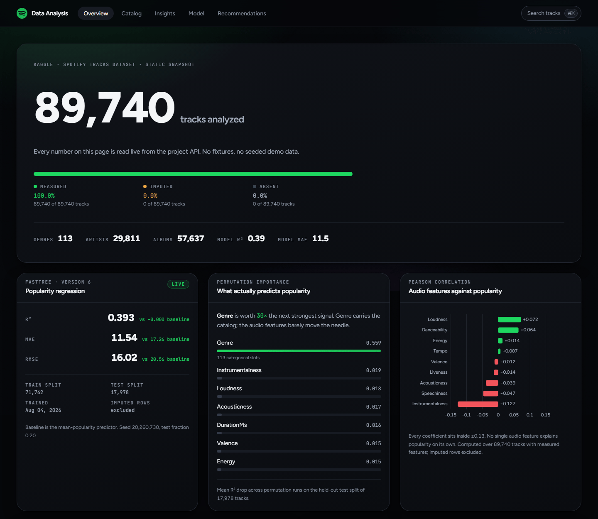
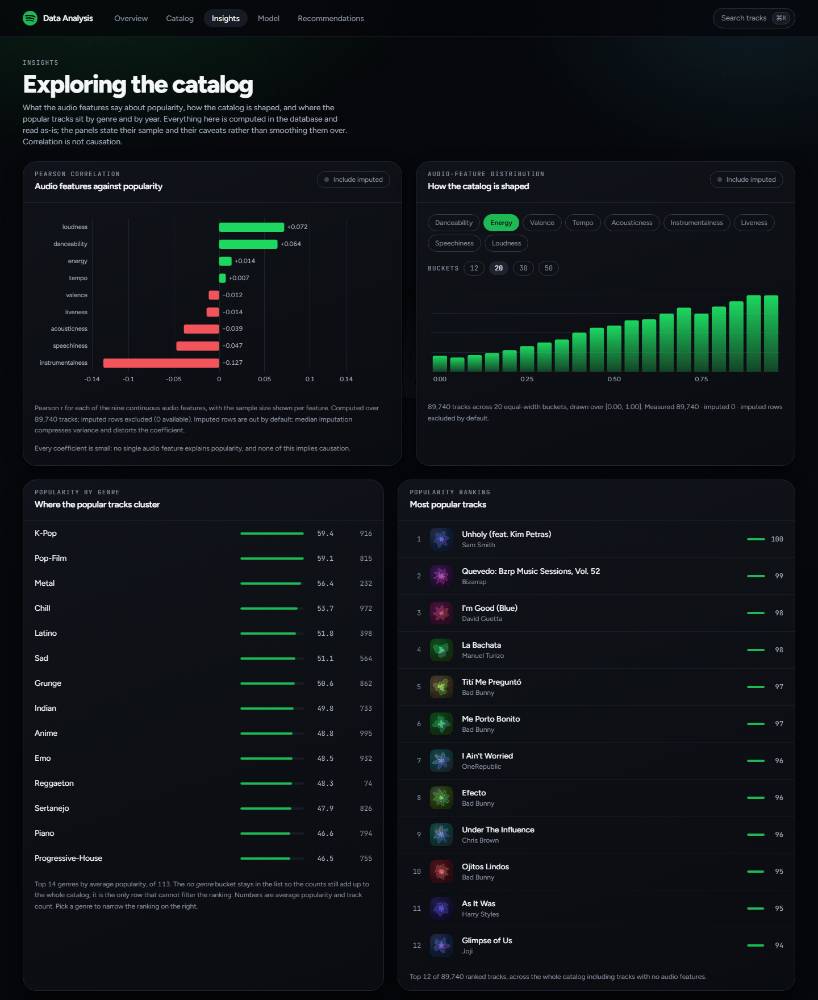
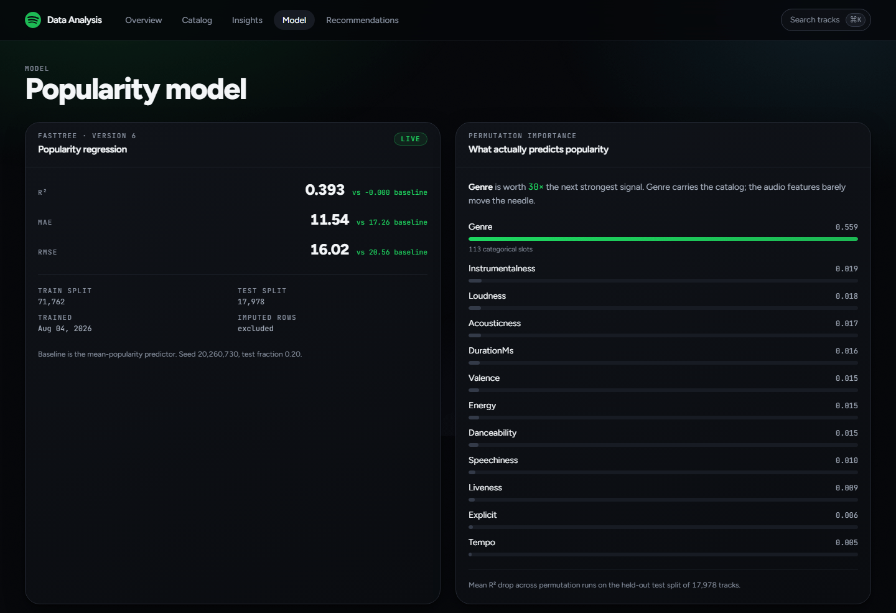
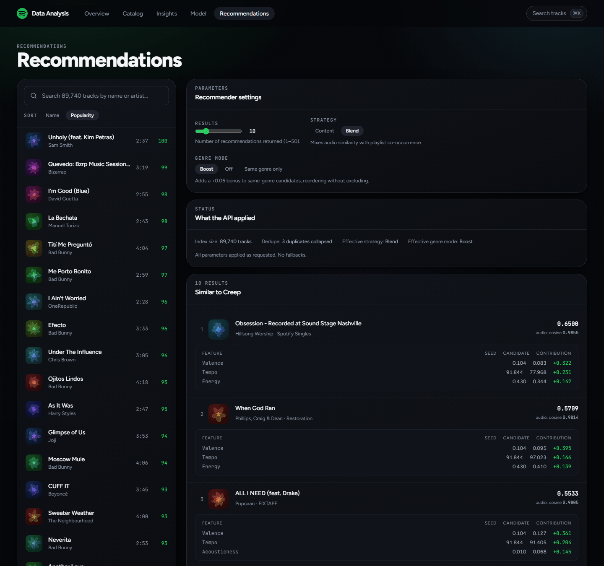
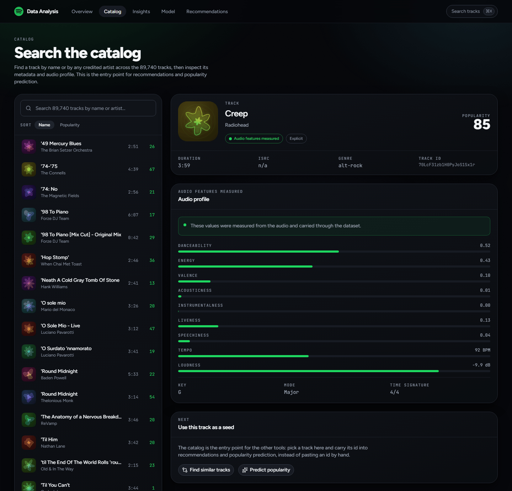
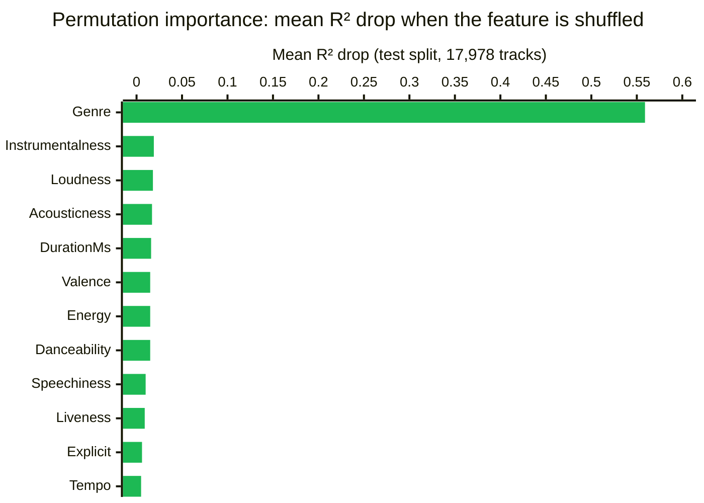
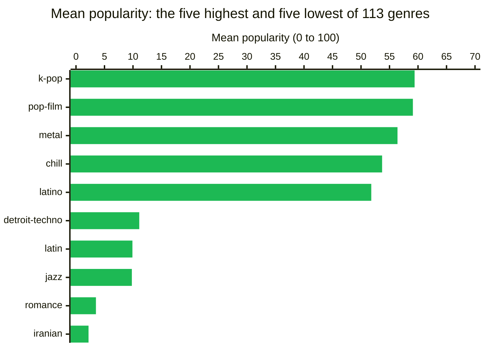
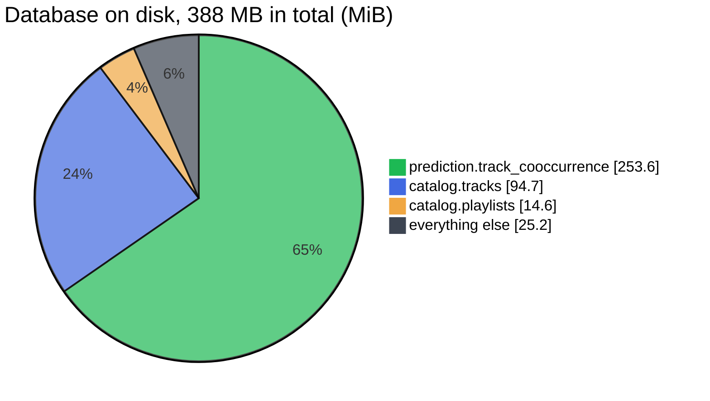
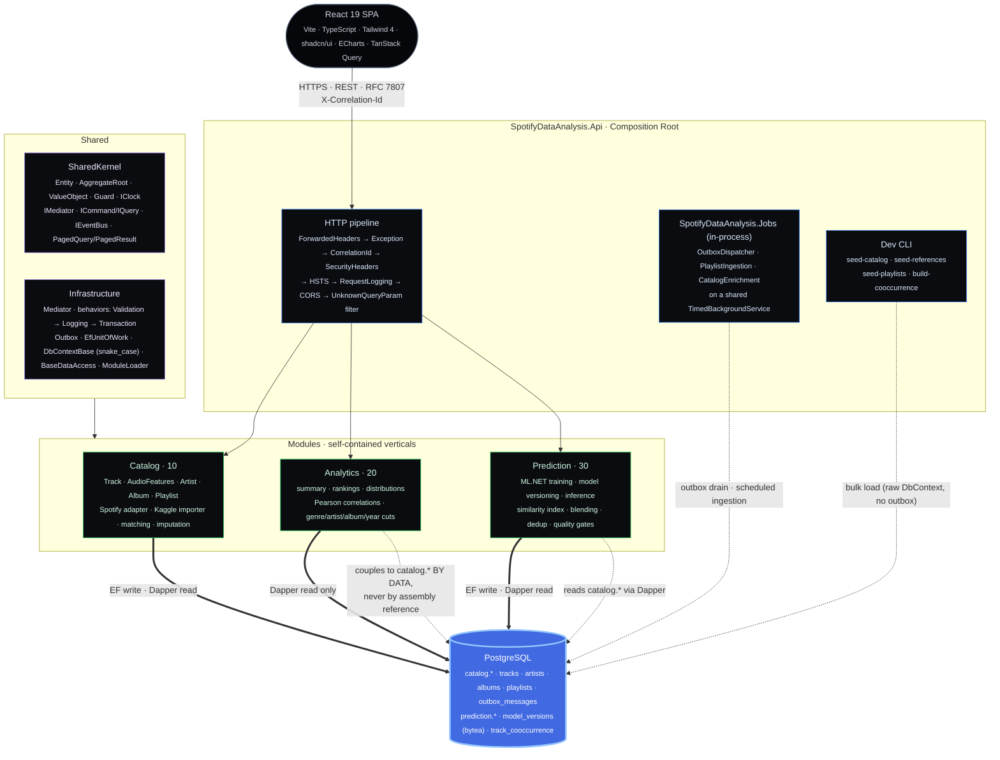

<h1 align="center">Spotify Data Analysis</h1>

<p align="center">
  <i>An end-to-end <b>data product</b> in .NET 8: resilient ingestion, EDA as a service, a<br/>
  <b>served ML model</b> and an <b>explainable recommender</b> over 89,740 tracks. DDD, CQRS and a<br/>
  modular monolith, with every claim in this README backed by a measurement in the repo.</i>
</p>

<p align="center">
  <a href="https://github.com/KauaVilasBoas/Spotify-Data-Analysis/actions/workflows/ci.yml">
    
  </a>
  
  
  
  
  <a href="https://www.conventionalcommits.org/">
    
  </a>
  <a href="LICENSE">
    
  </a>
</p>
<!-- LIVE DEMO: when the public deploy (E6) is up, add its badge here and a link under the hero image. -->

<p align="center">
  <b>89,740</b> tracks &nbsp;·&nbsp; <b>113</b> genres &nbsp;·&nbsp; <b>1.48M</b> co-occurrence pairs &nbsp;·&nbsp; <b>889</b> tests &nbsp;·&nbsp; <b>45</b> architecture rules &nbsp;·&nbsp; <b>MAE 11.54</b> (33.1% below baseline)
</p>

<p align="center">
  <a href="#what-is-this">Why</a> &nbsp;·&nbsp;
  <a href="#screenshots">Screens</a> &nbsp;·&nbsp;
  <a href="#what-the-data-says">Insights</a> &nbsp;·&nbsp;
  <a href="#how-it-works">How it works</a> &nbsp;·&nbsp;
  <a href="#results">Results</a> &nbsp;·&nbsp;
  <a href="#stack">Stack</a> &nbsp;·&nbsp;
  <a href="#quickstart">Quickstart</a> &nbsp;·&nbsp;
  <a href="#documentation">Docs</a>
</p>

<p align="center">
  
</p>

---

## What is this?

The brief was the standard data-analysis exercise: pull from the Spotify API, clean the data, run an
EDA, plot some charts, predict popularity, recommend similar tracks. The usual answer is a Jupyter
notebook.

**This is that brief taken to the end of the road.** The notebook became a system: a .NET 8 modular
monolith where ingestion is idempotent and resilient, the EDA is a paginated read-side over raw SQL,
the model is versioned and served behind an endpoint, and the recommender explains *why* it picked
each track, with a React SPA on top of all of it.

The interesting part is not the architecture, though. It is that **the project refuses to claim
anything it has not measured.**

> A one-hot encoding of `key` / `mode` / `time_signature` was added to the feature set, measured, and
> **deleted**, because it made MAE 0.12% *worse*. The genre block was measured in the same run, paid
> 23.92%, and stayed. The decision is a domain rule (`FeatureBlockGainPolicy`: a block survives only
> if it wins at least 2% of MAE on its own), not a judgement call.

That pattern repeats everywhere. The recommender's genre-boost weight went from `0.15` to `0.05`
because measurement showed that `0.15` made 82% of seeds return a single-genre top-10, a hard filter
wearing a boost costume. The model's quality gate is *relative to a baseline* rather than an absolute
MAE threshold, because only the comparison answers "did it learn anything?".

---

## Screenshots

Every screen reads the live API. Nothing below is a fixture or a mock-up.

| Insights | Model |
|---|---|
|  |  |
| Correlations, distributions, popularity by genre and the top of the ranking, each panel stating its sample and its caveats. | The served model against its baseline, and what it actually learned: genre carries it. |

| Recommendations | Catalog |
|---|---|
|  |  |
| Tracks similar to "Creep" under `strategy=blend`. Every item shows its score, its audio cosine, and the three features that pulled it close. | Track detail with the measured audio profile. The dataset has no cover images, so each sleeve is generated from the track's identity and audio profile. |

---

## What the data says

Six readings from the seeded catalogue, pulled from the running API and read-only SQL on 2026-10-19.
The endpoint or query behind every number is in
[ENGINEERING.md](ENGINEERING.md#reproducing-the-readme-insights).

### 1. No audio feature explains popularity on its own

Pearson r against popularity, over 89,740 tracks per feature: the strongest is `instrumentalness` at
**-0.127**, then `loudness` (+0.072) and `danceability` (+0.064). The other six sit inside ±0.05
(left panel of the Insights screenshot).

> Weak *linear* signal everywhere. At this stage the project's own prediction was that the model gate
> would fail. It did not, and the next chart is why.

### 2. Genre does



> Shuffling genre costs the model **0.559** of R². Shuffling the best audio feature costs **0.019**,
> about 30 times less. Adding the genre block alone took MAE from 15.17 to 11.54.

### 3. Genres live on different scales



> A **27x** spread between the highest genre mean (`k-pop`, 59.4 over 916 tracks) and the lowest
> (`iranian`, 2.2 over 988). The source's `latino` and `latin` labels sit 42 points apart.

### 4. The target is zero-inflated, and the zeros cluster by genre

The catalogue's mean popularity is 33.2 and its median 33, but **9,447 of 89,740 tracks (10.5%) score
exactly 0**. In five genres the zeros are the majority:

| Genre | Tracks | At popularity 0 | Share | Mean | Max |
|---|---:|---:|---:|---:|---:|
| `jazz` | 524 | 409 | **78.1%** | 9.8 | 77 |
| `iranian` | 988 | 648 | **65.6%** | 2.2 | 33 |
| `romance` | 904 | 555 | **61.4%** | 3.5 | 35 |
| `country` | 946 | 554 | **58.6%** | 17.3 | 89 |
| `latin` | 759 | 432 | **56.9%** | 9.9 | 98 |
| *whole catalogue* | 89,740 | 9,447 | 10.5% | 33.2 | 100 |

> `latin` has a track at 98 and more than half of its tracks at 0. A mean of 9.9 describes neither.

### 5. Genre still cannot see fame

"Creep" (Radiohead, `alt-rock`, measured features) sits at **85** in the catalogue. Model v6 predicts
**40.6** for it.

> R² is 0.393 for a reason: marketing, editorial playlisting and artist fame are not in an audio
> vector, and the artist columns that could carry them are all zeros (see
> [Known limitations](#known-limitations)).

### 6. The collaborative signal is sparse, and it is most of the disk



> Co-occurrence touches **9,664 of 89,740 tracks (10.8%)** but takes **254 of the 388 MB (65%)**.
> That ratio, not the absolute size, is the argument for pruning it by `co_playlists` before the
> catalogue grows.

---

## How it works

1. **Ingest.** The Spotify Web API removed its audio-features endpoint in November 2024, so a CLI loads
   two public Kaggle datasets into `catalog.*`: tracks with measured audio features and genre, their
   artists and albums, and 37,121 real playlists matched to tracks by a normalised artist and title key.
   The live Spotify adapter (Client Credentials, retry and backoff, `429` handling) remains for
   idempotent playlist ingestion through the Outbox.
2. **Analyse.** The Analytics module is a pure read-side: raw PostgreSQL through Dapper for summaries,
   rankings, distributions and correlations, served under `/api/insights/*`.
3. **Predict.** Prediction trains a FastTree regressor in ML.NET against two baselines on a
   deterministic split, elects the feature set by a domain rule, versions the model as `bytea`, and
   serves `/api/predictions/popularity`.
4. **Recommend.** An in-memory similarity index (z-score, cosine, kNN) is built in the background at
   startup. On request it can blend in Jaccard co-occurrence materialised from those playlists, collapses
   near-duplicate versions of the same work, and explains every item it returns.
5. **Show.** A React 19 SPA reads all of it, and no screen invents its own loading or error state.



<sub><b>Reading the diagram.</b> The Host composes modules by assembly scan (<code>ModuleLoader</code>, ordered by <code>IModule.Order</code>); each module's <code>IModule</code> lives in its Infrastructure project, so the dependency direction stays Infrastructure → Application → Domain and the Host never sees a module's Domain. Thick arrows are EF Core / Dapper I/O; dashed arrows are background access and data coupling. <b>Analytics deliberately has no schema of its own</b>: it reads <code>catalog.*</code> with raw SQL. That is coupling by <i>data</i>, not by code, since no Analytics assembly references any Catalog type, which is exactly what the architecture tests assert. Calling it out is the point; pretending otherwise would be the smell.</sub>

The full data pipeline, from each source CSV through every seeder to the served endpoints, is drawn in
[ENGINEERING.md](ENGINEERING.md#the-data-pipeline). A request-level walkthrough of one endpoint, class
by class, is in [ARQUITETURA.md](ARQUITETURA.md) (Portuguese).

### Highlights

- **Two-sided quality gate on the recommender.** This is the design decision I would defend first. A
  floor-only coherence gate is satisfied by cranking the genre boost until it becomes a hard filter. So
  coherence is charged three ways: an absolute floor, a **minimum lift** over pure cosine, and a
  **saturation ceiling**. Too little weight fails the lift; too much fails the saturation.
- **Honest baselines.** The model is measured against *two* baselines (always-predict-the-mean and a
  linear SDCA regressor) on a held-out test set, with 5-fold cross-validation and a fixed seed. Two runs
  with the same seed produced an identical MAE down to the last decimal.
- **Provenance is a first-class type.** `measured`, `imputed` and `absent` never share a colour, a
  label or a code path, and imputed tracks are excluded from training by a named policy.
- **Explainable recommendations.** Every item carries its cosine score and the genre boost
  *separately*, the top features that pulled it close in their original units, and the signal that
  backed it. Degradations are never silent.
- **Collaborative signal without user data.** Item-item co-occurrence mined from 37,121 real playlists,
  Jaccard-scored and **materialised** by a batch step. The request path never self-joins over jsonb.
- **Boundaries enforced by the build.** 45 ArchUnitNET facts fail `dotnet test` the moment a module
  reaches into another module's internals, or Domain touches EF Core, Dapper or ASP.NET.
- **Measured operations.** RAM and OOM verified in a container at 256 MB and 512 MB; latency and cold
  start measured at 0.1 CPU and without a limit. The conclusion: the free-tier bottleneck is CPU and
  disk, not RAM.

---

## Results

Every number below is reproduced by `dotnet test` (deterministic fixtures) or by re-running the
training endpoint against the seeded catalogue with the recorded seed. The full tables, each with the
configuration that produced it, are in [ENGINEERING.md](ENGINEERING.md#measured-not-claimed).

### Popularity model: champion election

Same split, same seed (`20260730`), same trainer (FastTree). Four feature sets measured, one elected.

| Feature set | R² | MAE | RMSE | MAE gain | Verdict |
|---|---:|---:|---:|---:|---|
| Baseline, always predict the mean | -0.0001 | 17.2555 | 20.5634 | n/a | reference |
| Baseline, linear (SDCA) | 0.0358 | 16.6640 | 20.1900 | n/a | reference |
| Base: 9 audio features + duration + explicit | 0.1519 | 15.1680 | 18.9356 | n/a | starting point |
| **+ A**: key / time-signature one-hot, mode boolean | 0.1524 | 15.1862 | 18.9303 | **-0.12%** | ❌ does not pay, **removed** |
| **+ B**: genre one-hot (113 plus an `<unknown>` bucket) | **0.3927** | **11.5396** | **16.0240** | **+23.92%** | ✅ **champion** |
| A + B | 0.3949 | 11.5076 | 15.9945 | n/a | carries a rejected block |

**Champion: base plus genre**, with **MAE 33.1% below** the mean baseline. 5-fold cross-validation puts
R² dispersion at **0.0046**, which is what licenses reading the feature-importance chart above as a
learned mechanism rather than a ranking of noise.

### Recommender: measured by proxies

There is no user ground truth, so quality is measured by proxies over the real catalogue: a fixed,
seeded sample of 300 seeds (top-10), plus the 1,895 seeds that sit inside the 111 duplicate groups of
11 or more tracks.

| Proxy | Without | With | Reads as |
|---|---:|---:|---|
| Genre coherence, without and with the `0.05` genre boost | 0.1140 | **0.5563** | 4.88x lift, the boost is actually breaking ties |
| Genre saturation (top-N all one genre), with the boost | n/a | **0.2800** | a minority, so a boost and not a filter |
| Same work twice in one top-N, without and with the near-duplicate collapse | 1,768 / 1,895 | **0 / 1,895** | the pain the collapse exists to remove |
| Fewer than 10 results, without and with adaptive over-fetch | 679 / 1,895 | **0 / 1,895** | a seed in a large duplicate group still gets its top-10 |
| Self-exclusion violations | n/a | **0 / 300** | the seed never recommends itself |

### Free-tier footprint

The similarity index fits in **256 MB** with no OOM across 1,800 sequential requests, and the whole
database is **388 MB** on disk. The free-tier bottleneck here is **CPU and disk, not RAM**. Latency and
cold start by CPU tier, with the methodology and its caveats, are in
[ENGINEERING.md](ENGINEERING.md#free-tier-footprint) and [`deploy/DEPLOY.md`](deploy/DEPLOY.md).

### Quality gates

Two gates run inside `dotnet test`, and both are **relative**. The model must beat the mean baseline's
MAE by at least 5%, never an invented absolute number. The recommender is charged on nine thresholds,
from both sides, each bound to the configuration and the population that calibrated it. Details in
[ENGINEERING.md](ENGINEERING.md#quality-gates).

---

## Stack

| Layer | Technology |
|---|---|
| Runtime | .NET 8 and ASP.NET Core 8, `TreatWarningsAsErrors` solution-wide |
| Architecture | Modular monolith with DDD, CQRS and Outbox; 3 bounded contexts; single-tenant |
| Write-side | EF Core 8 and PostgreSQL (snake_case, schema per module, one `DbContext` per module) |
| Read-side | Dapper with raw SQL; query, handler and result record sealed in one file; `ROW_NUMBER() + COUNT(*) OVER()` pagination |
| Machine learning | ML.NET 3.0, FastTree regression, permutation feature importance, model versioned as `bytea` |
| Recommendation | z-score normalisation, cosine, in-memory kNN top-N; item-item Jaccard co-occurrence; explainable blend; near-duplicate collapse |
| In-process messaging | Custom `IMediator` and `IEventBus`, with behaviors ordered Validation, Logging, Transaction |
| Background jobs | `OutboxDispatcher`, `PlaylistIngestion` and `CatalogEnrichment` on a shared `TimedBackgroundService` |
| External integration | Spotify Web API with Client Credentials, token cache and refresh, retry with exponential backoff, 429 `Retry-After` handling, cursor pagination |
| Frontend | React 19, Vite 8, TypeScript 6 (`strict`, `noUncheckedIndexedAccess`), Tailwind 4, shadcn/ui, ECharts 6, TanStack Query, cmdk for the command palette, Motion |
| Security | Security headers, HSTS, forwarded-headers hardening, unknown-query-parameter rejection, RFC 7807, secrets only in User Secrets or environment variables |
| Observability | Serilog with JSON console output, correlation ids end to end, request logging, `/health` with a Postgres probe |
| Testing | xUnit, ArchUnitNET, hand-written fakes instead of a mocking framework. **826 tests across 7 projects** |
| CI | GitHub Actions: clean-clone build in Release, full test run, and a step that **names every skipped test and the reason**, so "green" never means "did not run" |

---

## Quickstart

The API in a container, against a PostgreSQL that already holds the catalogue:

```powershell
docker build -t spotifydataanalysis-api .
docker run --rm -p 8080:8080 -e ConnectionStrings__SpotifyDb="Host=host.docker.internal;Port=5432;Database=spotify_data_analysis;Username=postgres;Password=<password>" spotifydataanalysis-api
curl http://localhost:8080/health
```

Starting from an empty database (migrations, the two Kaggle datasets, the seeding CLI), running the SPA,
training the model and every test gate: **[GETTING_STARTED.md](GETTING_STARTED.md)**.

---

## Known limitations

Stated here rather than left for whoever reads the code to discover. The full table, with the cause
and what would lift each one, is in [ENGINEERING.md](ENGINEERING.md#known-limitations).

- **R² of 0.393 is the ceiling of audio features alone.** The model beats the mean baseline by 33.1%
  on MAE, which is the honest claim.
- **`artists.popularity` and `followers` are `0` across all 29,811 artists**, because enrichment needs
  the Spotify API and the catalogue is seeded from CSV. No insight above uses them.
- **`release_year` is null across the catalogue, and no album cover exists.** The UI says so instead of
  hiding it, and generates deterministic art per track.
- **The imputation path has never run against real data**: the seeded catalogue has 0 imputed tracks.
- **The recommender gate does not measure `strategy=blend`**, by design.

---

## Roadmap

| Epic | Focus | Status |
|---|---|---|
| **E0** Spotify integration | Client Credentials auth with token cache and refresh, retry with backoff, 429 handling, pagination, DTO mapping | ✅ Shipped |
| **E1** Ingestion and catalogue | Track, AudioFeatures, Artist, Album and Playlist aggregates; idempotent ingestion with Outbox; Kaggle importer; matching chain; median imputation; scheduled job | ✅ Shipped |
| **E2** Analytics and EDA | Dapper read-side: summary, paginated ranking, distributions, Pearson correlations, and genre, artist, album and year cuts | ✅ Shipped |
| **E3** Popularity model | Training dataset assembly, FastTree plus two baselines, relative quality gate, versioned model in `bytea`, inference endpoint, permutation feature importance | ✅ Shipped |
| **E4** Recommendations | Content-based cosine kNN, explainability, genre as a relaxable boost, proxy evaluation with a two-sided gate, Pichl seeding, materialised co-occurrence blend, near-duplicate collapse | ✅ Shipped |
| **E5** React SPA | Visual foundation and typed data layer, Overview, Catalog, Insights, Model | ✅ Shipped |
| **E5.4** Recommendations screen | Pick a track, get similar tracks with the explanation panel | ✅ Shipped |
| **E6** Operations | CI on clean clone ✅, containerisation ✅, forwarded headers ✅, unknown-query-parameter rejection ✅, background index warm-up ✅, **public deploy** 🚧, automated backup with a *tested* restore, minimal monitoring | 🚧 In progress |
| Scheduled retraining | Model retrained on a schedule, versioned and promoted by policy | Planned |
| Artist-level features (Block C) | The measured ceiling on R², which needs API enrichment first | Planned |

The full backlog, with acceptance criteria per card, lives on the
[Trello board](https://trello.com/b/1nHOJ9P1).

---

## Engineering workflow

- **Task-first.** No branch without a card, and no card without acceptance criteria. Two
  role-specialised agents drive it: one refines specs into cards, the other implements them.
- **[Conventional Commits](https://www.conventionalcommits.org/).** Atomic commits on feature
  branches; `main` only moves by `--no-ff` merge. Commit bodies carry the *measurements* and the
  decisions, which is why this README could be written from the history.
- **Definition of Done.** `dotnet build` with 0 warnings and 0 errors, and `dotnet test` green with
  the architecture suite included. Not negotiable per card.
- **Boundaries are tested, not documented.** `dotnet test` is the architecture review.
- **CI on every push and pull request.** Clean-clone restore, Release build with warnings as errors,
  full test run with skipped tests named in the summary, plus SPA typecheck, lint
  (`--max-warnings=0`) and build.

---

## Documentation

| Document | Contents |
|---|---|
| [`GETTING_STARTED.md`](GETTING_STARTED.md) | Prerequisites, configuration, migrations, data load, running the API and the SPA, training, Docker, tests and troubleshooting |
| [`ENGINEERING.md`](ENGINEERING.md) | The deep dive: data pipeline, every measurement with its configuration, both quality gates, data provenance, engineering decisions, API surface, design system, known limitations, and how to reproduce the insights above |
| [`ARQUITETURA.md`](ARQUITETURA.md) | Code walkthrough in Portuguese: one request followed end to end, class by class, then the map of the rest |
| [`documentacao/arquitetura-tecnica.pdf`](documentacao/arquitetura-tecnica.pdf) | Technical monograph in Portuguese: the maths and data structures behind similarity, selection, blending and concurrency |
| [`frontend/DESIGN.md`](frontend/DESIGN.md) | The visual contract: tokens, measured contrast, motion, generated track art, bundle budget, and the three domain rules that outlive any palette |
| [`frontend/README.md`](frontend/README.md) | SPA setup, environment variables, and how the front talks to the API (`ApiResult`, `PagedResult`, ProblemDetails) |
| [`deploy/DEPLOY.md`](deploy/DEPLOY.md) | Deployment runbook, measured resource footprint, dump and restore, and the co-occurrence pruning options for a small disk |
| [Trello board](https://trello.com/b/1nHOJ9P1) | Live backlog with acceptance criteria per card |

---

## Data and attribution

Data comes from **public Kaggle datasets**, never from the Spotify API. **Spotify** is a trademark of
**Spotify AB**, and this project is **not affiliated with, endorsed by, or connected to Spotify** in
any way. Neither CSV is redistributed in this repository; the download step is documented instead,
which keeps the load reproducible without republishing someone else's dataset.

---

## Author

**Kauã Vilas Boas**, Backend and Full-Stack Developer (.NET, C#)

<p>
  <a href="https://www.linkedin.com/in/kauavilasboas/">
    
  </a>
  <a href="https://github.com/KauaVilasBoas">
    
  </a>
  <a href="https://www.nuget.org/profiles/kauavilasboas">
    
  </a>
  <a href="mailto:kauacaldeira@hotmail.com">
    
  </a>
</p>

Related work: **[SISLAB](https://github.com/KauaVilasBoas/SISLAB)**, a multi-tenant LIMS for a real
pharmacology lab with 7 bounded contexts on the same architectural foundation, and
**[Lumen](https://github.com/KauaVilasBoas/Lumen)**, permission-based IAM libraries published to
NuGet.

Based in Brazil (UTC-3), with full overlap with US East Coast and European afternoon working hours.
Open to remote opportunities.

---

## License

Released under the [MIT License](LICENSE). Copyright (c) 2026 Kauã Vilas Boas.
